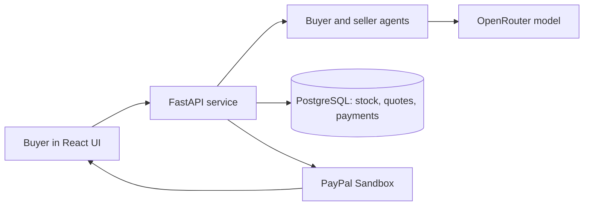

# AgentNegotiate

**AI-assisted negotiation for bulk orders, from buyer requirements to a stock-backed quote and PayPal Sandbox checkout.**

[Live demo](https://agentnegotiate.onrender.com/) · [Implementation plan](implementation_plan.md) · [MIT license](LICENSE)

AgentNegotiate is a hackathon prototype. It uses real model calls and PayPal Sandbox transactions in **Live API Mode**; inventory, fulfillment, and the example merchant policy are simulated. **Local Fixture Mode** is a separate browser-only simulation and does not call the model, reserve database stock, or make PayPal API calls.

## The problem

A bulk buyer may need part of an order by one date, the rest later, and an acceptable mix of colors—all within a total budget. A lower-priced offer can still fail if it misses a delivery milestone or requests unavailable stock. Negotiating those constraints manually and then ensuring the checkout amount matches the agreed terms is time-consuming and error-prone.

AgentNegotiate explores a more structured workflow: a buyer agent and seller agent exchange proposed actions, while server-side rules check the resulting agreement against the buyer's requirements, a simulated seller policy, and dated inventory. Only an eligible agreement can become a reserved quote and proceed to PayPal Sandbox authorization.

## How it works

1. The buyer enters an order quantity, cumulative delivery deadlines, allowed colors, and a private total budget.
2. Buyer and seller agents take turns negotiating price and delivery. In live mode, each turn calls the configured OpenRouter model; responses must pass typed validation.
3. The backend checks an accepted offer against the buyer's budget and deadlines, the simulated seller floor, and available stock. An ineligible or impossible deal cannot issue a quote.
4. An eligible agreement becomes a time-limited quote backed by simulated inventory reservations in PostgreSQL.
5. The buyer reviews the quote and approves a PayPal Sandbox checkout. The server creates the order using the stored quote amount and records the authorization.
6. A merchant-only flow can record **simulated fulfillment** and capture the authorization in Sandbox. Payment status is persisted so a refresh can restore it.

Negotiation has a six-turn limit. A provider failure may interrupt a run; it is not converted into a scripted agreement. Payment operations use stored request IDs and keep uncertain outcomes pending for reconciliation.



### Example scenario

A buyer wants **30 shirts**, at least **12 by November 13, 2026**, all 30 by **November 16, 2026**, and a maximum total of **USD 360**. Navy is preferred and black is allowed. A valid split can deliver 12 navy shirts first and 18 black shirts later, provided the agreed total and available stock satisfy the server's checks.

These are fixed **demo dates and simulated stock**, not a live merchant catalog. An actual model run may propose different valid terms or fail to reach a deal. The quote expiry uses real server time.

## Tech stack

| Area | Technology | Purpose |
| --- | --- | --- |
| Buyer interface | React, TypeScript, Vite | Order form, negotiation transcript, quote and checkout status |
| API and application server | Python, FastAPI, Uvicorn | Negotiation and payment endpoints, session handling, serving frontend assets |
| AI | OpenRouter API with an explicitly configured free model | Generates buyer and seller negotiation actions |
| Validation | Pydantic | Validates model actions and application contracts before business rules run |
| Database | PostgreSQL, Psycopg | Stores inventory, negotiations, quotes, reservations, and payment operations |
| Payments | PayPal JavaScript SDK and PayPal Sandbox REST APIs | Buyer approval, authorization, and merchant-triggered capture |
| Hosting | Render | Hosts the integrated FastAPI service and frontend; PostgreSQL can be configured separately |
| Tests | Python `unittest`, pytest, PostgreSQL integration tests | Exercises contracts, payment handoff, recovery, and inventory behavior |

The OpenRouter client currently reuses validation types from the `google-genai` dependency; Gemini is not the live model provider. See [OpenRouter setup](backend/domain/OPENROUTER.md) for model configuration and limitations.

## Try the interface without credentials

Use this route to explore the UI only. Fixture results are simulated and are not evidence of a real model or PayPal transaction.

**Prerequisite:** Node.js 20.19+ or 22.12+ and npm.

```bash
git clone https://github.com/ParticlePioneer/PayPal_Hackathon.git
cd PayPal_Hackathon
npm ci --prefix frontend
npm run dev --prefix frontend
```

Open the URL printed by Vite, select **Local Fixture Mode (Simulated)**, and choose a scenario. On Windows PowerShell, use `npm.cmd` instead of `npm` if the execution policy blocks `npm.ps1`.

## Run the integrated app locally

This setup runs live OpenRouter requests and **PayPal Sandbox** calls against a local app and a PostgreSQL database. Use a dedicated disposable database for the demo; the seed modifies inventory. The commands below use Windows PowerShell. On macOS or Linux, use the virtual environment's `bin/python` and your shell's equivalent for setting environment variables.

### 1. Prerequisites and accounts

- Python 3.10+, Node.js 20.19+ or 22.12+, npm, and PostgreSQL.
- An OpenRouter API key and an available model whose ID ends in `:free`.
- A PayPal **Sandbox REST app** client ID and secret, plus a Sandbox personal buyer account distinct from the Sandbox business seller account.
- A new, disposable PostgreSQL database and its connection URL.

Provider capacity and free-model availability can change. The repository defaults to `dots-studio/dots-3-note-preview:free`; select another explicit free model if needed and test that it produces valid actions. Do not share keys, database URLs, or merchant tokens in issues, logs, or chat.

### 2. Install dependencies

From the repository root:

```powershell
python -m venv .venv
.\.venv\Scripts\python.exe -m pip install -r backend/requirements.txt -r backend/domain/requirements.txt
npm.cmd ci --prefix frontend
```

### 3. Configure the server

Copy `.env.example` to `.env` if you do not already have a local `.env`:

```powershell
if (-not (Test-Path .env)) { Copy-Item .env.example .env }
```

Edit `.env` and set these values:

| Variable | Value or purpose |
| --- | --- |
| `DATABASE_URL` | URL of the disposable PostgreSQL database |
| `SESSION_SECRET` | A random secret of at least 32 characters |
| `OPENROUTER_API_KEY` | Your server-side OpenRouter key |
| `OPENROUTER_MODEL` | An explicit available `:free` model ID |
| `PAYPAL_CLIENT_ID` | Your PayPal Sandbox REST app client ID |
| `PAYPAL_CLIENT_SECRET` | Your PayPal Sandbox REST app secret |
| `B4_ENABLED` | `true` for the integrated app |
| `MERCHANT_MINIMUM_TOTAL_CENTS` | `30000` for the simulated USD 300 demo floor |
| `B2_RUN_MIGRATIONS` | `true` for the initial database setup |
| `B4_SEED_SCENARIO` | `split` for the initial synthetic stock seed |
| `B4_ACKNOWLEDGE_SYNTHETIC_STOCK` | `true` for that initial seed |

Leave the B2/B3 test harness, B5 capture, and fault-injection flags disabled unless you are following their specific test instructions. For a local session secret, you can generate a random value with `python -c "import secrets; print(secrets.token_urlsafe(48))"` and put it in `.env`. Keep `.env` private and do not commit it.

### 4. Build the frontend

The frontend needs the **public Sandbox client ID** at build time. This is the same client ID as `PAYPAL_CLIENT_ID`; never put the PayPal secret or OpenRouter key in a `VITE_` variable.

```powershell
$env:VITE_DEFAULT_MODE = "api"
$env:VITE_PAYPAL_CLIENT_ID = Read-Host "Public PayPal Sandbox client ID"
npm.cmd run build --prefix frontend
Remove-Item Env:VITE_DEFAULT_MODE, Env:VITE_PAYPAL_CLIENT_ID
```

### 5. Start and initialize

```powershell
.\.venv\Scripts\python.exe -m uvicorn backend.main:app --env-file .env --host 127.0.0.1 --port 8000
```

On this first start, the app applies **domain migrations before payment migrations** and adds the simulated split stock. Check the startup logs for migration and seed success. Open:

- App: `http://127.0.0.1:8000/`
- Process health: `http://127.0.0.1:8000/health`
- Interactive API documentation: `http://127.0.0.1:8000/docs`

Stop the server after successful setup, set `B2_RUN_MIGRATIONS=false`, and clear `B4_SEED_SCENARIO` / set `B4_ACKNOWLEDGE_SYNTHETIC_STOCK=false` in `.env`. Start it again with the same command. A health response of `{"status":"ok"}` verifies the web process, not database, model, or PayPal connectivity.

The seed is repeat-safe for matching stock and does not reset reservations or allocations. It is **not a stock reset**. Never reseed or change inventory on a shared database without coordinating with its owner.

### 6. Run a live Sandbox journey

1. In the app, select **Live API Mode**, load the standard 30-shirt request, and start the negotiation.
2. Advance the agents or select **Complete Negotiation (Auto-Step)**. Review the quote and its expiry if an eligible agreement is reached.
3. Open Checkout and use the actual PayPal button. Sign in with the Sandbox personal buyer if prompted, review the quoted amount, and approve.
4. Confirm the app displays the authorization ID and that refreshing the buyer session restores its status.

If you see **Simulate PayPal Buyer Approval**, you are in Fixture Mode. A simulated approval is not a Sandbox transaction. A timeout, provider error, expired quote, or no-deal outcome may prevent checkout. The PayPal client ID must be present when the frontend is built for the button to load.

A separate merchant-only capture flow is disabled by default and requires explicit simulated-fulfillment confirmation. See [B5 Sandbox rehearsal](backend/payments/B5_REHEARSAL.md) for the capture and recovery procedure. Do not start a replacement payment when an existing outcome is unknown.

## Test and verify

Run payment tests from the repository root:

```powershell
.\.venv\Scripts\python.exe -B -m unittest discover -s backend/payments/tests -v
```

PostgreSQL integration tests require `TEST_DATABASE_URL` pointing to a **disposable** database whose user can create and drop schemas. Without it, those tests are skipped. The clean-install check creates and deletes a uniquely named test schema:

```powershell
$env:TEST_DATABASE_URL = Read-Host "Disposable PostgreSQL URL"
.\.venv\Scripts\python.exe -B -m backend.payments.clean_install_check
Remove-Item Env:TEST_DATABASE_URL
```

For domain tests, install the development requirements and run pytest:

```powershell
.\.venv\Scripts\python.exe -m pip install -r backend/domain/requirements-dev.txt
.\.venv\Scripts\python.exe -B -m pytest backend -q -p no:cacheprovider
```

Tests using fixture agents or mocked providers do not prove live OpenRouter or PayPal behavior. Report skipped database tests separately. Recorded Sandbox and test evidence is in [B5 evidence](backend/payments/B5_EVIDENCE.md).

## Deployment

The included [Render configuration](render.yaml) installs backend dependencies, builds the frontend with the public PayPal client ID in API mode, and starts one FastAPI service. An existing service's environment must be configured and verified separately; the blueprint defaults B4 and startup migrations to disabled. See the [B4 deployment guide](backend/payments/B4_DEPLOYMENT.md) for environment variables, migration order, synthetic seeding, and acceptance checks.

Use only Sandbox PayPal credentials for this prototype. Free-model rate limits or provider outages can interrupt negotiations. The deployed service may also require replenished **simulated** stock before another successful demo; existing allocations and uncertain payment claims must be preserved.

## Repository structure

```text
backend/domain/       Negotiation agents, contracts, stock, quotes, and domain migrations
backend/payments/     PayPal integration, persistence, reconciliation, and payment migrations
backend/main.py       FastAPI application and integrated frontend serving
frontend/             React buyer interface and PayPal button
qa/                   Acceptance and submission materials
implementation_plan.md  Team milestones and integration contracts
render.yaml           Render deployment configuration
```

## Additional documentation

- [Negotiation API and session contract](backend/domain/API.md)
- [OpenRouter configuration and model smoke check](backend/domain/OPENROUTER.md)
- [Payment setup and testing](backend/payments/README.md)
- [B4 deployment and acceptance](backend/payments/B4_DEPLOYMENT.md)
- [B5 Sandbox capture rehearsal](backend/payments/B5_REHEARSAL.md)
- [B5 evidence and known limits](backend/payments/B5_EVIDENCE.md)

## License

[MIT License](LICENSE). Copyright (c) 2026 AgentNegotiate contributors.
